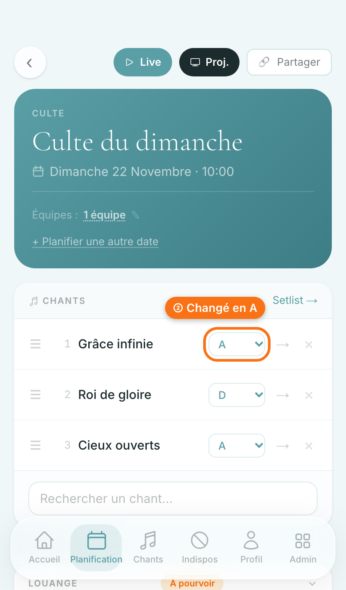
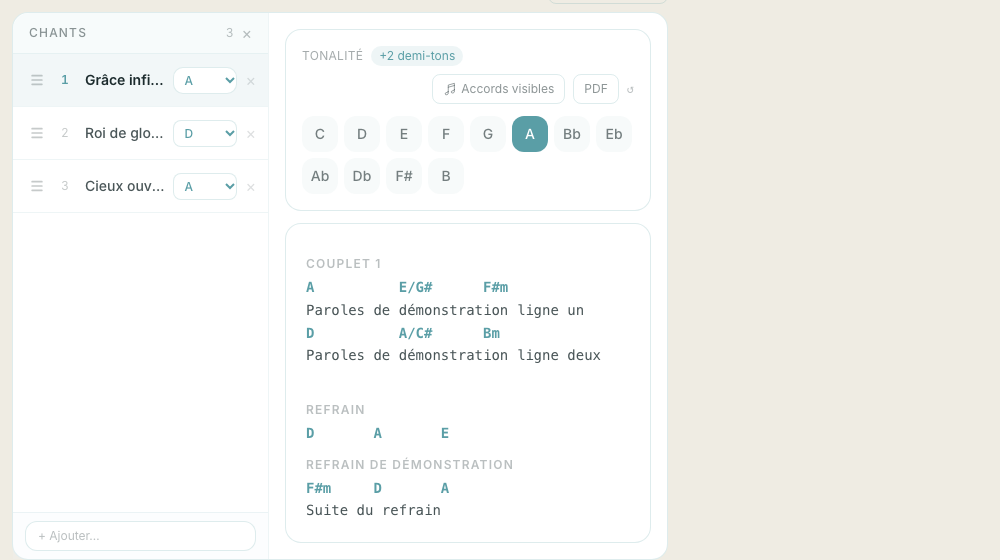

# Changer la tonalité d'un chant après coup

Quand on prépare une liste de chants (un plan), on choisit une tonalité à l'ajout du chant.
Vous pouvez maintenant **la modifier à tout moment**, sans supprimer ni ré-ajouter le chant.

> Version visuelle avec captures et vidéo : [`changer-la-tonalite.html`](changer-la-tonalite.html)
> (un seul fichier, à ouvrir dans un navigateur). Vidéo seule : [`video/changer-la-tonalite.webm`](video/changer-la-tonalite.webm).

## Où le faire ?

### 1. Depuis la liste des chants du plan (le plus rapide)

1. Ouvrez le plan : **Planification → le culte concerné**.
2. Dans le bloc **Chants**, chaque chant a un petit menu déroulant de tonalité (ex. `G`).
3. Touchez le menu et choisissez la nouvelle tonalité.

C'est enregistré tout de suite : pas de bouton « Valider ». Si l'enregistrement échoue,
la tonalité revient à l'ancienne et un message d'erreur rouge s'affiche sous le menu.

### 2. Depuis la grille d'accords (sur ordinateur)

1. Dans le bloc **Chants**, cliquez sur le titre du chant pour ouvrir sa grille.
2. Cliquez sur une des tonalités (`C`, `D`, `E`, `F`, `G`…) au-dessus de la grille.
   Les accords sont transposés et la tonalité est enregistrée pour ce plan.
3. Le bouton **↺** remet la tonalité d'origine du chant.

Si vous changez la tonalité par le menu de la liste pendant que la grille est ouverte,
la grille se met à jour automatiquement.

### 3. Pendant la répétition / le culte (vue Setlist)

Dans **Setlist**, les boutons de tonalité de la grille fonctionnent de la même façon et
sont aussi enregistrés pour le plan.

## Ce qui est bon à savoir

- **Par plan, par chant** : changer la tonalité dans un plan ne modifie pas le chant
  dans la bibliothèque, ni les autres plans.
- **Tonalités proposées** : la tonalité actuelle, celle d'origine, celles renseignées
  pour l'arrangement, puis les tonalités courantes (C, D, E, F, G, A, B, Bb, Eb, Ab, Db, F#).
- **Qui peut modifier ?** Les administrateurs (même droit que pour ajouter ou retirer un chant).
- La page de partage et l'impression PDF utilisent la tonalité enregistrée.

## Pour les développeurs

| Élément | Fichier |
|---|---|
| Menu de tonalité | `app/benevoles/admin/plans/[id]/PlanSongKeySelect.tsx` |
| Liste des options | `lib/songKeys.ts` (`getKeyOptions`) |
| Action serveur | `updatePlanSongKey(planSongId, key, planId)` dans `app/benevoles/admin/plans/actions.ts` |
| Liste mobile / bureau | `MobileSongsList.tsx` / `SongsSection.tsx` |

Tests : `npx vitest run lib/songKeys.test.ts "app/benevoles/admin/plans/[id]"`
